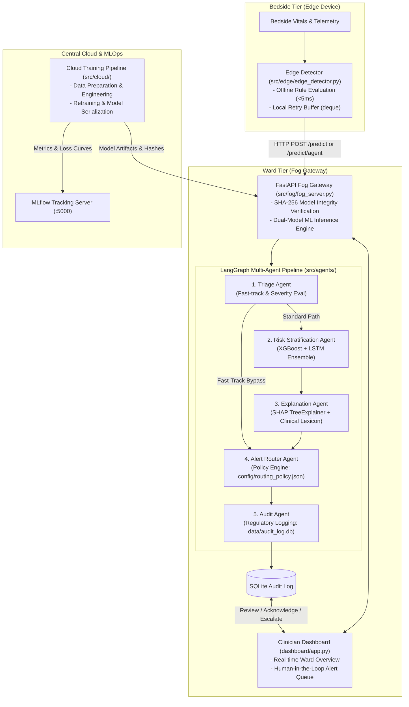

# ICU Patient Deterioration Prediction

[](https://www.python.org/downloads/)
[](https://fastapi.tiangolo.com/)
[](https://pytorch.org/)
[](https://xgboost.readthedocs.io/)
[](https://github.com/langchain-ai/langgraph)
[](https://streamlit.io/)
[](https://www.docker.com/)

> **A safety-critical, 3-tier distributed Clinical Decision Support System (CDSS) for predicting ICU patient deterioration 6–12 hours in advance using an explainable LangGraph multi-agent framework.**

---

## Table of Contents
- [Executive Overview](#executive-overview)
- [Architecture & Data Flow](#architecture--data-flow)
- [Key Innovations & Features](#key-innovations--features)
- [Repository Structure](#repository-structure)
- [Multi-Agent Decision Support](#multi-agent-decision-support)
- [Quickstart Guide](#quickstart-guide)
  - [1. Local Environment Setup](#1-local-environment-setup)
  - [2. Running the Services](#2-running-the-services)
  - [3. One-Command Docker Compose](#3-one-command-docker-compose)
- [Dataset & Model Training](#dataset--model-training)
  - [MIMIC-III Dataset](#mimic-iii-dataset)
  - [Training & MLflow Tracking](#training--mlflow-tracking)
- [Testing & Quality Assurance](#testing--quality-assurance)
- [Configuration & Security](#configuration--security)
- [Documentation Index](#documentation-index)

---

## Executive Overview

Predicting patient decompensation in Intensive Care Units (ICUs) requires balancing **immediate response latency** with **deep temporal pattern recognition**. Monolithic cloud architectures suffer from network latency and data privacy constraints, while simplistic bedside monitors produce overwhelming false-alarm rates.

This platform resolves these challenges by combining:
1. **Bedside Edge Devices** (<5 ms response time) executing rule-based anomaly detection with offline queuing.
2. **Ward-Level Fog Gateway** (<50 ms response time) running a dual-model ensemble (XGBoost + PyTorch LSTM sequence model).
3. **LangGraph Multi-Agent Engine** incorporating automated triage, fast-track emergency routing, exact SHAP explainability, and hospital policy enforcement.
4. **Human-in-the-Loop Clinician Dashboard** providing ward-wide risk heatmaps, trajectory visualizations, and an actionable alert queue with persistent audit logging.

---

## Architecture & Data Flow



*For an in-depth breakdown of tier responsibilities, latency budgets, and failover mechanics, see [docs/ARCHITECTURE.md](docs/ARCHITECTURE.md).*

---

## Key Innovations & Features

- **3-Tier Distributed Topology**: Partitioned processing across Bedside (Edge), Ward Gateway (Fog), and Cloud (MLOps) ensures resilient operation even during hospital network outages.
- **Dual-Model Clinical Ensemble**:
  - **Static Tree Classifier (XGBoost)**: Rapidly scores high-dimensional clinical and administrative acuity proxies.
  - **Sequence Modeling (PyTorch Stacked LSTM)**: Ingests rolling multi-timestep observation sequences (`patient_windows`) to evaluate physiological trajectories.
  - **Ensemble Blend**: $0.90 \times \text{XGBoost} + 0.10 \times \text{LSTM}$.
- **LangGraph Multi-Agent Clinical Workflow**: Modular agents pass a strongly typed [`AgentState`](file:///home/dhruvk27/Documents/Projects/ICU-Deterioration/src/agents/agent_state.py) through conditional routing edges.
- **Explainable AI (SHAP)**: Automatically calculates feature-level contributions using `shap.TreeExplainer` and converts raw database features into human-readable clinical narratives via [`config/feature_descriptions.json`](file:///home/dhruvk27/Documents/Projects/ICU-Deterioration/config/feature_descriptions.json).
- **Human-in-the-Loop (HITL) Alert Queue**: High-risk alerts require clinician review. Intensivists can **Acknowledge**, **Dismiss**, or **Escalate** alerts directly from the Streamlit UI, persisting clinical rationale into SQLite.
- **Cryptographic Model Verification**: Model weights (`xgb_model.pkl`, `lstm_model.pt`, `scaler.pkl`) are validated at startup via SHA-256 hashes to guarantee data integrity.
- **Configurable Hospital Routing Policies**: Alert dispatch targets and priorities are fully customizable via [`config/routing_policy.json`](file:///home/dhruvk27/Documents/Projects/ICU-Deterioration/config/routing_policy.json).

---

## Repository Structure

```
ICU-Deterioration/
├── config/                         # Declarative policies and mappings
│   ├── feature_descriptions.json   # Maps raw DB columns to clinical concepts
│   └── routing_policy.json         # Ward-specific alert routing rules
├── dashboard/                      # Streamlit Clinician UI
│   ├── .streamlit/                 # UI configuration
│   └── app.py                      # Ward monitor & HITL alert review queue
├── data/                           # Data storage (gitignored raw/processed)
│   ├── audit_log.db                # SQLite regulatory audit trail
│   ├── processed/                  # Normalized parquet data splits & scaler.pkl
│   └── raw/                        # MIMIC-III CSV source files
├── docker/                         # Multi-tier containerization
│   ├── Dockerfile.cloud            # Cloud training environment
│   ├── Dockerfile.dashboard        # Streamlit dashboard container
│   ├── Dockerfile.edge             # Bedside edge simulator container
│   └── Dockerfile.fog              # Ward FastAPI gateway container
├── docs/                           # Technical documentation & guides
│   ├── API_REFERENCE.md            # Complete REST API specification
│   ├── ARCHITECTURE.md             # In-depth system design & latency budgets
│   ├── DEPLOYMENT.md               # Operations, Docker Compose, & security
│   └── MULTI_AGENT_SYSTEM.md       # LangGraph agent engine & HITL lifecycle
├── models/                         # Serialized weights & schemas
│   ├── feature_names.json          # 41-feature schema ordering
│   ├── lstm_config.json            # LSTM architectural parameters
│   ├── lstm_model.pt               # Trained PyTorch sequence model weights
│   └── xgb_model.pkl               # Trained XGBoost classifier
├── src/                            # Core application source code
│   ├── agents/                     # LangGraph Multi-Agent CDSS
│   │   ├── agent_state.py          # TypedDict schema & state factory
│   │   ├── audit_agent.py          # SQLite audit logger & table schemas
│   │   ├── explanation_agent.py    # SHAP TreeExplainer & natural language generator
│   │   ├── orchestrator.py         # StateGraph compilation & conditional edges
│   │   ├── risk_agent.py           # Dual-model ensemble evaluation
│   │   ├── router_agent.py         # Hospital routing policy evaluator
│   │   └── triage_agent.py         # Fast-track triage rules
│   ├── cloud/                      # Data pipeline & model training
│   │   ├── data_pipeline.py        # Cleaning, feature engineering, parquet export
│   │   ├── eval_ensemble.py        # AUROC, PR-AUC, calibration evaluation
│   │   ├── run_training.py         # Unified model training runner
│   │   ├── train_lstm.py           # PyTorch LSTM sequence trainer
│   │   └── train_xgboost.py        # XGBoost trainer & hyperparameter tuning
│   ├── edge/                       # Bedside device layer
│   │   └── edge_detector.py        # Offline anomaly detector (<5ms) & retry queue
│   └── fog/                        # Ward inference gateway
│       ├── fog_server.py           # FastAPI server with dual models & agent API
│       └── test_fog_integration.py # Live thread-based gateway integration test
├── tests/                          # Automated QA & validation suite
│   ├── README.md                   # Detailed testing documentation
│   ├── conftest.py                 # Pytest fixtures & FastAPI TestClient
│   ├── test_agents.py              # Multi-agent LangGraph integration tests
│   └── test_inference.py           # Pydantic boundary & ML inference test suite
├── docker-compose.yml              # Local/ward multi-container orchestration
├── render.yaml                     # Render.com deployment blueprint
└── requirements.txt                # Production and testing dependencies
```

---

## Multi-Agent Decision Support

The multi-agent workflow replaces opaque algorithmic scoring with an auditable clinical decision chain:

```
[ Bedside Telemetry ]
          │
          ▼
┌──────────────────┐
│ 1. Triage Agent  │ ──(Immediate Life Threat?)──► [ 4. Router Agent ]
└──────────────────┘                                      │
          │ (No)                                          │
          ▼                                               │
┌──────────────────┐                                      │
│  2. Risk Agent   │ (XGBoost + LSTM Ensemble)            │
└──────────────────┘                                      │
          │                                               │
          ▼                                               │
┌──────────────────┐                                      │
│ 3. Explanation   │ (SHAP Attribution & Clinical Terms)  │
└──────────────────┘                                      │
          │                                               │
          ▼                                               │
┌──────────────────┐                                      │
│ 4. Router Agent  │ ◄────────────────────────────────────┘
└──────────────────┘
          │
          ▼
┌──────────────────┐
│  5. Audit Agent  │ ──► [ SQLite data/audit_log.db ]
└──────────────────┘
          │
          ▼
[ Clinician Queue: Review -> Acknowledge / Dismiss / Escalate ]
```

- **Triage Agent**: Detects acute emergencies and triggers fast-track routing.
- **Risk Stratification Agent**: Runs the 41-feature XGBoost model and historical window PyTorch LSTM.
- **Explanation Agent**: Derives exact SHAP attributions, maps features via [`feature_descriptions.json`](file:///home/dhruvk27/Documents/Projects/ICU-Deterioration/config/feature_descriptions.json), and generates clinical justifications.
- **Alert Router Agent**: Matches risk and triggers against [`routing_policy.json`](file:///home/dhruvk27/Documents/Projects/ICU-Deterioration/config/routing_policy.json) to dispatch to the correct clinical role (`attending_physician`, `charge_nurse`, `nurse`).
- **Audit Agent**: Stores complete state snapshots into [`data/audit_log.db`](file:///home/dhruvk27/Documents/Projects/ICU-Deterioration/data/audit_log.db) for regulatory compliance.

*For complete agent specifications, see [docs/MULTI_AGENT_SYSTEM.md](docs/MULTI_AGENT_SYSTEM.md).*

---

## Quickstart Guide

### 1. Local Environment Setup

```bash
# Clone repository
git clone https://github.com/DhruvK278/ICU-Deterioration.git
cd ICU-Deterioration

# Set up virtual environment
python3 -m venv venv
source venv/bin/activate

# Install dependencies
pip install -r requirements.txt
```

### 2. Running the Services

Open three terminal windows (with `venv` activated in each):

**Terminal 1 — Ward Fog Inference Server**:
```bash
uvicorn src.fog.fog_server:app --host 0.0.0.0 --port 8000 --reload
```
*API docs available at `http://localhost:8000/docs`.*

**Terminal 2 — Clinician Dashboard**:
```bash
streamlit run dashboard/app.py
```
*Dashboard available at `http://localhost:8501`.*

**Terminal 3 — Bedside Edge Simulator**:
```bash
python src/edge/edge_detector.py --fog-url http://localhost:8000
```

### 3. One-Command Docker Compose

To run the entire system (Fog Server, Dashboard, Bedside Simulator, and MLflow) using Docker:

```bash
# Start all containers in the background
docker-compose up --build -d

# Tail Fog server logs
docker-compose logs -f fog

# Stop all containers
docker-compose down
```

*For production deployment details, see [docs/DEPLOYMENT.md](docs/DEPLOYMENT.md).*

---

## Dataset & Model Training

### MIMIC-III Dataset
- **Database**: MIMIC-III Clinical Database (Simplified 3D extract).
- **Target Variable**: `expiredhospital` (In-hospital mortality, binary classification).
- **Features**: 40+ clinical variables including patient demographics (`age`, `gender`), admission characteristics, diagnosis categories (`dx_sepsis`, `dx_cardiac`, `dx_respiratory`, `dx_trauma`), procedure counts, laboratory event volumes, and engineered interaction indices (`acuity_score`, `totalnuminteract`).

### Training & MLflow Tracking

Run the unified cloud training pipeline to train both the XGBoost and LSTM models:
```bash
python src/cloud/run_training.py
```

To run training for a specific model architecture:
```bash
python src/cloud/run_training.py --model xgb    # XGBoost baseline only
python src/cloud/run_training.py --model lstm   # PyTorch LSTM only
```

#### Viewing Metrics in MLflow
Start the local MLflow server:
```bash
mlflow ui --host 0.0.0.0 --port 5000
```
Navigate to **http://localhost:5000** to compare AUROC, PR-AUC, Brier score, and training loss curves.

---

## Testing & Quality Assurance

The repository includes a comprehensive testing suite combining API contract tests and multi-agent pipeline verification:

### Run All Tests
```bash
pytest tests/ -v
```

### Test Breakdown
- **API Schema & Validation Suite** ([`tests/test_inference.py`](file:///home/dhruvk27/Documents/Projects/ICU-Deterioration/tests/test_inference.py)):
  - Validates 200 OK responses, JSON contract shapes, and bounded risk ranges $[0.0, 1.0]$.
  - Confirms 422 errors on omitted required fields (`hadm_id`).
  - Verifies rejection of invalid data types and out-of-range clinical inputs (`age` > 120).
- **Multi-Agent Pipeline Suite** ([`tests/test_agents.py`](file:///home/dhruvk27/Documents/Projects/ICU-Deterioration/tests/test_agents.py)):
  - Validates full LangGraph execution, fast-track routing, SHAP TreeExplainer generation, and SQLite audit persistence.
- **Live Fog Gateway Integration Test** ([`src/fog/test_fog_integration.py`](file:///home/dhruvk27/Documents/Projects/ICU-Deterioration/src/fog/test_fog_integration.py)):
  - Background uvicorn execution validating health checks, rolling patient windows, and patient discharge cleanup.

*For complete testing documentation, see [tests/README.md](tests/README.md).*

---

## Configuration & Security

- **Authentication**: Set the `FOG_API_KEY` environment variable to enforce `X-API-Key` header authentication across all operational endpoints.
- **Model Checksums**: Set `XGB_MODEL_HASH`, `LSTM_MODEL_HASH`, and `SCALER_HASH` to prevent model tampering or weight drift in production.
- **Routing Policies**: Customize alert thresholds, priorities, and clinical targets in [`config/routing_policy.json`](file:///home/dhruvk27/Documents/Projects/ICU-Deterioration/config/routing_policy.json).
- **Clinical Feature Lexicon**: Update [`config/feature_descriptions.json`](file:///home/dhruvk27/Documents/Projects/ICU-Deterioration/config/feature_descriptions.json) to map custom clinical variables to clinician-friendly descriptions.

---

## Documentation Index

| Guide | Description |
| :--- | :--- |
| [**Architecture Deep Dive**](docs/ARCHITECTURE.md) | 3-tier distributed topology, latency budgets, failover, and data flow |
| [**REST API Reference**](docs/API_REFERENCE.md) | Endpoint specifications, schemas, status codes, and curl examples |
| [**Multi-Agent Decision Support**](docs/MULTI_AGENT_SYSTEM.md) | LangGraph orchestrator, `AgentState`, individual agents, and HITL workflow |
| [**Deployment & Operations**](docs/DEPLOYMENT.md) | Docker Compose, environment variables, Render setup, and security checklist |
| [**Testing & QA Guide**](tests/README.md) | Pytest suites, contract assertions, and integration testing |
