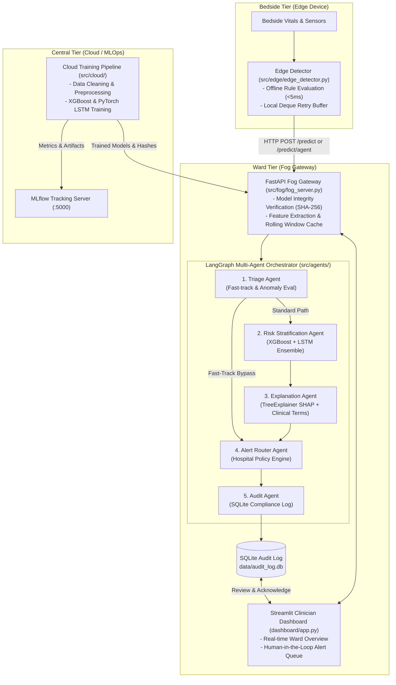

# System Architecture & Technical Design

## Overview

The **ICU Patient Deterioration Prediction System** is a distributed, safety-critical Clinical Decision Support System (CDSS) designed to detect impending patient deterioration **6–12 hours in advance**.

The platform is structured as a **hybrid Edge-Fog-Cloud architecture** coupled with a **deterministic Multi-Agent Decision Support Engine** orchestrated via LangGraph. This design solves three core challenges in healthcare ML:
1. **Ultra-low latency bedside alerting** (<5 ms) for life-threatening events.
2. **Ward-level context & temporal sequence modeling** (<50 ms) without streaming raw protected health information (PHI) to external clouds.
3. **Transparent, policy-governed clinical actions** via explainable AI (SHAP) and human-in-the-loop verification.

---

## High-Level Topology

---

## Architectural Tiers

### 1. Bedside Tier (Edge Device)
- **Component**: [`src/edge/edge_detector.py`](file:///home/dhruvk27/Documents/Projects/ICU-Deterioration/src/edge/edge_detector.py)
- **Deployment**: Raspberry Pi 4 / local medical device microcontroller at the bedside.
- **Latency**: `< 5 ms`.
- **Purpose**:
  - Direct ingestion of real-time telemetry and bedside clinical inputs.
  - Zero-dependency, purely deterministic rule evaluations against clinical thresholds (e.g., severe lab volume surges, abnormal transfer counts, prolonged length of stay, extreme acuity scores).
  - Categorizes readings into **CRITICAL**, **WARNING**, **WATCH**, or **NORMAL**.
  - **Offline Resilience**: Maintained via a rolling `collections.deque` buffer (default capacity 100). If the ward gateway is unreachable or experiences network drops, readings are cached locally and retried upon reconnection.

### 2. Ward Tier (Fog Inference Gateway & Decision Support)
- **Component**: [`src/fog/fog_server.py`](file:///home/dhruvk27/Documents/Projects/ICU-Deterioration/src/fog/fog_server.py)
- **Deployment**: On-premise server or gateway located on the hospital ward network.
- **Latency**: `< 50 ms` end-to-end.
- **Core Responsibilities**:
  1. **Cryptographic Model Verification**: SHA-256 hashes of all model weights (`xgb_model.pkl`, `lstm_model.pt`, `scaler.pkl`) are validated at startup to prevent tampering or weight corruption.
  2. **Feature Alignment**: Safely maps incoming dictionary payloads into the strictly ordered 41-feature schema expected by the models (`models/feature_names.json`).
  3. **Dual-Model Ensemble Scoring**:
     - **Static Baseline**: Gradient boosted decision trees (XGBoost) evaluate static risk from cumulative acuity metrics.
     - **Temporal Sequence Modeling**: Stacked LSTM (`ICULSTMClassifier` in PyTorch) models temporal trajectories across rolling patient observation windows (`patient_windows`).
     - **Weighted Blend**: $0.90 \times \text{XGBoost} + 0.10 \times \text{LSTM}$ (falls back gracefully to $1.00 \times \text{XGBoost}$ if historical sequence is insufficient).
  4. **Multi-Agent LangGraph Pipeline**: Executes modular agent nodes for triage, explanation, policy routing, and regulatory audit logging.
  5. **Stateful Caches**: In-memory rolling history (`patient_risk_history`) per patient admission ID (`hadm_id`), supporting real-time querying and ward overview dashboards.

### 3. Clinician UI & Human-in-the-Loop Dashboard
- **Component**: [`dashboard/app.py`](file:///home/dhruvk27/Documents/Projects/ICU-Deterioration/dashboard/app.py)
- **Deployment**: Streamlit interface accessible to nurses, intensivists, and charge nurses on ward workstations or mobile tablets.
- **Capabilities**:
  - Color-coded ward overview showing all active admissions.
  - Live patient risk trajectories and historical vital trends.
  - **Human-in-the-Loop (HITL) Alert Queue**: Displays pending critical and high alerts. Clinicians can review SHAP-derived risk drivers and execute auditable actions: **Acknowledge**, **Dismiss**, or **Escalate** with optional clinical rationales.

### 4. Cloud / MLOps Tier
- **Components**: [`src/cloud/`](file:///home/dhruvk27/Documents/Projects/ICU-Deterioration/src/cloud/) (`data_pipeline.py`, `train_xgboost.py`, `train_lstm.py`, `run_training.py`, `eval_ensemble.py`).
- **Deployment**: Centralized cloud cluster or high-performance GPU compute.
- **Responsibilities**:
  - Processing raw MIMIC-III database extracts (`data/raw/`).
  - Feature normalization and temporal train/val/test splitting.
  - Hyperparameter tuning and model retraining.
  - Logging experiment runs, loss curves, and AUROC/PR-AUC metrics to the centralized **MLflow Tracking Server**.
  - Exporting serialized model artifacts and updated hash checksums down to the ward fog nodes.

---

## Latency & Safety Budgets

| Step | Component | Target Latency | Failure Fallback |
| :--- | :--- | :--- | :--- |
| **Bedside Anomaly** | `edge_detector.py` | $< 5\text{ ms}$ | Bedside audio/visual alarms |
| **Edge Forwarding** | HTTP Client | $< 15\text{ ms}$ | Local deque buffer (auto-retry) |
| **Feature Extraction** | `fog_server.py` | $< 2\text{ ms}$ | Strict 422 validation response |
| **XGBoost Scoring** | CPU Inference | $< 5\text{ ms}$ | Edge rule level fallback |
| **LSTM Scoring** | PyTorch CPU | $< 15\text{ ms}$ | $100\%$ XGBoost fallback |
| **SHAP Computation** | `TreeExplainer` | $< 10\text{ ms}$ | Bypassed if risk $< 0.30$ or fast-tracked |
| **Routing & Audit** | LangGraph + SQLite | $< 5\text{ ms}$ | Default to charge nurse & log |
| **Total System Turnaround** | Bedside to Dashboard | **$< 60\text{ ms}$** | Graceful tier degradation |

---

## Security & Compliance Architecture

- **Role-Based Routing**: Strict adherence to ward policies defined in [`config/routing_policy.json`](file:///home/dhruvk27/Documents/Projects/ICU-Deterioration/config/routing_policy.json) ensures critical alerts reach attending physicians while lower-severity alerts route to bedside nurses or monitoring logs.
- **Model Integrity Safeguards**: The server checks cryptographic hashes on startup. Unrecognized or altered model weights trigger `RuntimeError` and halt boot.
- **Zero-Mock Audit Trail**: Every execution of the agent pipeline persists complete JSON state snapshots into [`data/audit_log.db`](file:///home/dhruvk27/Documents/Projects/ICU-Deterioration/data/audit_log.db). When a clinician responds to an alert, their action (`acknowledge`, `dismiss`, `escalate`), timestamp, and notes update the audit record directly.
- **Network Boundaries & API Keys**: Inter-tier communication can be secured with `FOG_API_KEY` header verification (`X-API-Key`) and CORS domain whitelisting.
