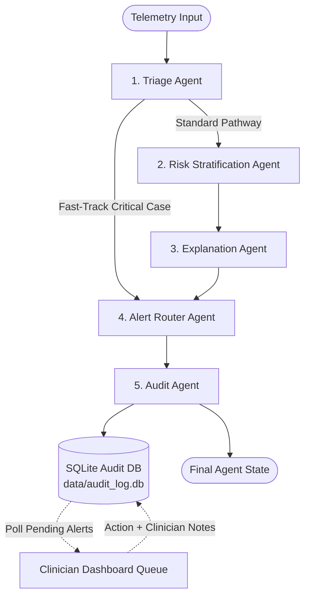

# Multi-Agent Clinical Decision Support System

## Overview

In critical care medicine, black-box ML predictions without context frequently lead to **alert fatigue** or **delayed intervention**. The ICU Deterioration Prediction platform replaces monolithic prediction scripts with a **deterministic Multi-Agent Framework** orchestrated using **LangGraph**.

Each specialized agent encapsulates a distinct clinical responsibility—triage, risk quantification, explainability, policy routing, and compliance logging.

---

## Architecture & Graph Flow

The pipeline is compiled as a LangGraph `StateGraph` in [`src/agents/orchestrator.py`](file:///home/dhruvk27/Documents/Projects/ICU-Deterioration/src/agents/orchestrator.py).



### Conditional Branching (`should_fast_track`)
If a patient presents with an immediate life-threatening physiological collapse (e.g. edge alert level is `CRITICAL` or severe multi-threshold failure), running full sequence modeling and SHAP attribution would waste precious seconds. 

The graph conditionally evaluates `should_fast_track`:
- **If True**: Bypasses the ML scoring and SHAP explanation agents, immediately transferring control to the **Alert Router Agent** to sound emergency attending-physician alarms.
- **If False**: Executes the full analytical pipeline (`Risk -> Explanation -> Router`).

---

## Shared Agent State Schema (`AgentState`)

All agents communicate by reading and mutating a strongly typed dictionary defined in [`src/agents/agent_state.py`](file:///home/dhruvk27/Documents/Projects/ICU-Deterioration/src/agents/agent_state.py):

```python
class AgentState(TypedDict):
    # 1. Identity & Context
    patient_id: int
    timestamp: str
    run_id: str                          # UUID tracking this evaluation run
    
    # 2. Triage Agent Outputs
    edge_level: Literal["CRITICAL", "WARNING", "WATCH", "NORMAL"]
    edge_triggers: List[str]
    fast_track: bool                     # If True, bypasses ML scoring
    
    # 3. Risk Stratification Agent Outputs
    xgb_risk: Optional[float]
    lstm_risk: Optional[float]
    ensemble_risk: Optional[float]
    feature_vector: Optional[List[float]]
    
    # 4. Explanation Agent Outputs
    shap_values: Optional[Dict[str, float]]   # feature_name -> shap_attribution
    top_contributors: Optional[List[str]]     # Top 3 features pushing risk UP
    clinical_summary: Optional[str]           # Clinician-facing narrative
    explanation_method: Optional[str]         # e.g., "shap+template"
    
    # 5. Alert Router Agent Outputs
    alert_priority: Optional[Literal["critical", "high", "medium", "low", "log_only"]]
    route_target: Optional[Literal["attending_physician", "nurse", "charge_nurse", "log"]]
    alert_id: Optional[str]                  # Unique alert identifier
    
    # 6. Human-in-the-Loop Feedback (Dashboard / Clinician API)
    pending_approval: bool
    clinician_action: Optional[Literal["acknowledge", "dismiss", "escalate"]]
    clinician_notes: Optional[str]
    
    # 7. Telemetry & Diagnostics
    errors: List[str]                         # Resilient error accumulator
    latency_ms: Dict[str, float]              # Step-by-step latency profiling
    raw_reading: Dict[str, Any]
```

---

## Detailed Agent Breakdown

### 1. Triage Agent ([`src/agents/triage_agent.py`](file:///home/dhruvk27/Documents/Projects/ICU-Deterioration/src/agents/triage_agent.py))
- **Role**: Immediate admission inspection and fast-track determination.
- **Logic**: Inspects incoming edge severity level and edge triggers. If `edge_level == "CRITICAL"`, marks `fast_track = True`.
- **Latency**: `< 1 ms`.

### 2. Risk Stratification Agent ([`src/agents/risk_agent.py`](file:///home/dhruvk27/Documents/Projects/ICU-Deterioration/src/agents/risk_agent.py))
- **Role**: Quantitative dual-model inference.
- **Logic**: Extracts features from `raw_reading`, evaluates the trained XGBoost tree classifier, retrieves recent temporal window history for the patient, computes LSTM sequence probability, and applies ensemble weighting ($0.90 \times \text{XGBoost} + 0.10 \times \text{LSTM}$).
- **Latency**: `10–25 ms`.

### 3. Explanation Agent ([`src/agents/explanation_agent.py`](file:///home/dhruvk27/Documents/Projects/ICU-Deterioration/src/agents/explanation_agent.py))
- **Role**: Explainable AI (XAI) feature attribution and clinical translation.
- **Explainability Engine**: Computes exact Shapley values using `shap.TreeExplainer(xgb_model)`.
- **Clinical Mapping**: Translates raw database column identifiers (e.g., `numlabs`, `numchartevents`, `numtransfers`) into clear, human-readable clinical terminology using [`config/feature_descriptions.json`](file:///home/dhruvk27/Documents/Projects/ICU-Deterioration/config/feature_descriptions.json).
- **Compute Optimization**: Explanation is skipped if the patient is low-risk (`ensemble_risk < 0.30`) or fast-tracked, avoiding unnecessary compute overhead.
- **Output**: Generates a natural-language clinical justification:
  > *"Elevated risk (84.2%) driven primarily by: laboratory test frequency (+1.87), procedural volume (+1.19), diagnostic complexity (+0.94)."*

### 4. Alert Router Agent ([`src/agents/router_agent.py`](file:///home/dhruvk27/Documents/Projects/ICU-Deterioration/src/agents/router_agent.py))
- **Role**: Hospital policy enforcement and alert dispatching.
- **Policy Configuration**: Evaluates rules defined declaratively in [`config/routing_policy.json`](file:///home/dhruvk27/Documents/Projects/ICU-Deterioration/config/routing_policy.json).
- **Dispatching Matrix**:
  | Minimum Risk | Edge Triggers | Priority | Target Clinical Role | Pending Approval? |
  | :--- | :--- | :--- | :--- | :--- |
  | Any ($0.0$) | `CRITICAL` | `critical` | Attending Physician | Yes (`True`) |
  | $\ge 0.80$ | Any | `high` | Attending Physician | Yes (`True`) |
  | Any ($0.0$) | `WARNING`, `WATCH` | `high` | Charge Nurse | Yes (`True`) |
  | $\ge 0.50$ | Any | `medium` | Bedside Nurse | No (`False`) |
  | $\ge 0.30$ | Any | `low` | Bedside Nurse | No (`False`) |
  | Default | Any | `log_only` | Log Archive | No (`False`) |

### 5. Audit Agent ([`src/agents/audit_agent.py`](file:///home/dhruvk27/Documents/Projects/ICU-Deterioration/src/agents/audit_agent.py))
- **Role**: Regulatory compliance, audit logging, and audit trail maintenance.
- **Database**: Local SQLite database at [`data/audit_log.db`](file:///home/dhruvk27/Documents/Projects/ICU-Deterioration/data/audit_log.db).
- **Database Schema**:
  ```sql
  CREATE TABLE alerts (
      run_id TEXT PRIMARY KEY,
      patient_id INTEGER,
      timestamp TEXT,
      edge_level TEXT,
      fast_track BOOLEAN,
      ensemble_risk REAL,
      alert_priority TEXT,
      route_target TEXT,
      clinical_summary TEXT,
      pending_approval BOOLEAN,
      clinician_action TEXT,
      clinician_notes TEXT,
      full_state_json TEXT
  );
  ```

---

## Human-in-the-Loop (HITL) Workflow

Critical and high-priority alerts require human confirmation to prevent alarm desensitization and uphold clinical accountability:

1. **Triggering**: Router Agent flags `pending_approval = True`.
2. **Persistence**: Audit Agent writes the alert row with `pending_approval = 1`.
3. **Queue Ingestion**: The Streamlit Clinician Dashboard polls `GET /alerts/pending` every 10 seconds.
4. **Clinician Review**: The attending physician or charge nurse views the patient card, ensemble score, SHAP explanation, and top driving risk factors.
5. **Action Submission**: Clinician selects an action:
   - **Acknowledge**: Confirms alert validity and clinical intervention underway.
   - **Dismiss**: Identifies false alarm or non-actionable baseline state.
   - **Escalate**: Elevates to Rapid Response Team (RRT) or ICU intensivist.
6. **Audit Finalization**: Dashboard invokes `POST /alerts/{alert_id}/action`. The database record is updated (`pending_approval = 0`, `clinician_action = ...`, `clinician_notes = ...`), providing an end-to-end regulatory paper trail.

---

## Running Agent Tests

The complete multi-agent pipeline is tested continuously using Pytest:

```bash
pytest tests/test_agents.py -v
```

This validates:
- Graph compilation and state flow execution.
- Fast-track conditional branching logic.
- SHAP TreeExplainer calculation against active models.
- Policy rule matching and priority assignment.
- SQLite audit persistence and schema consistency.
